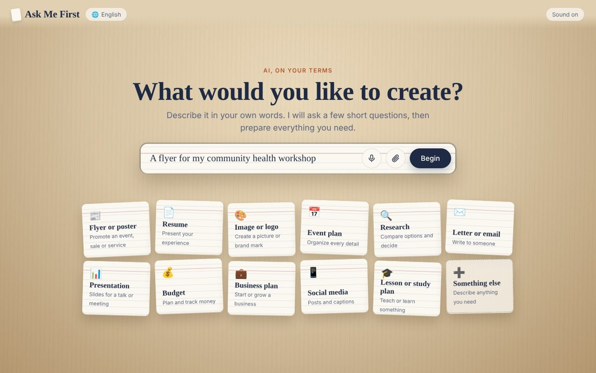
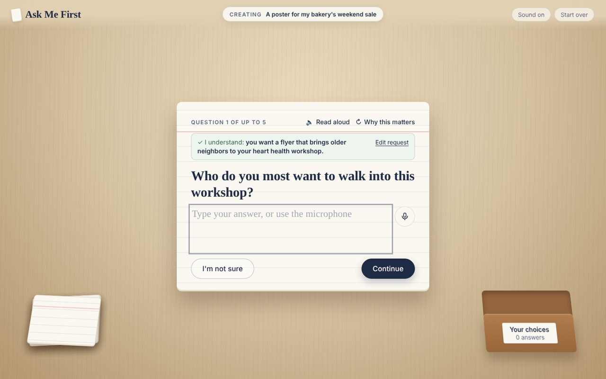
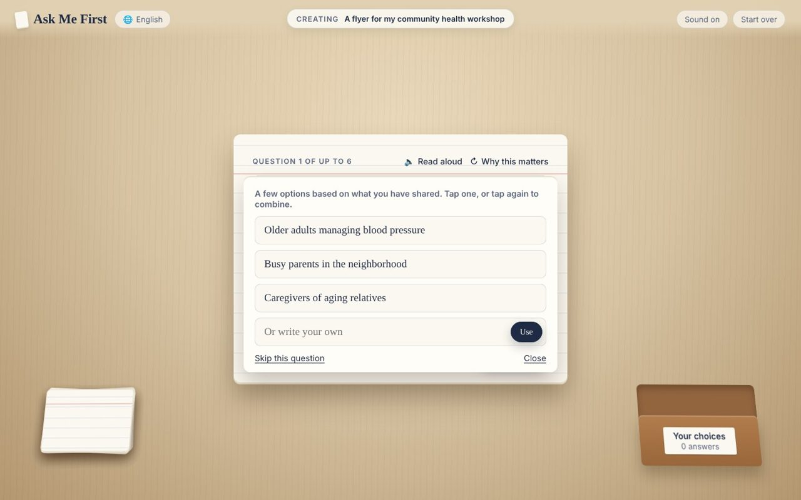
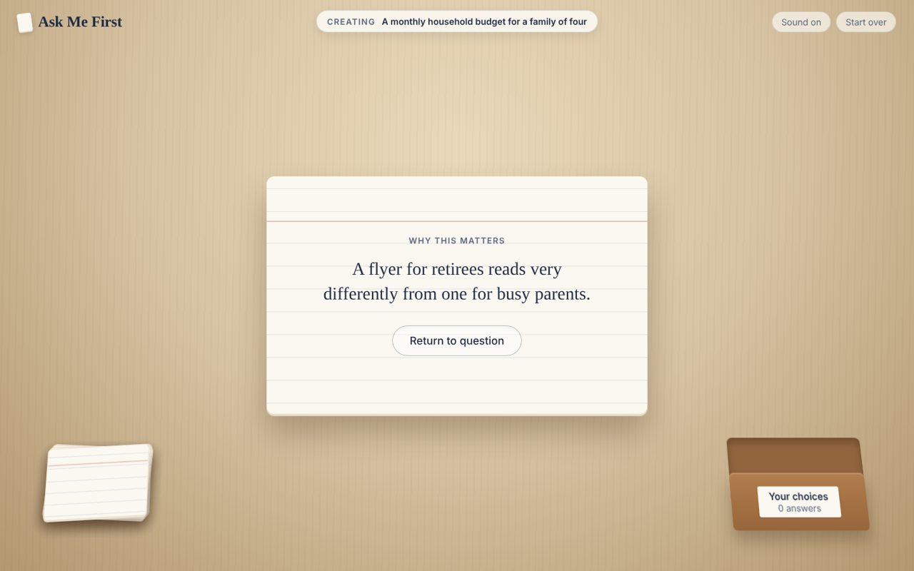
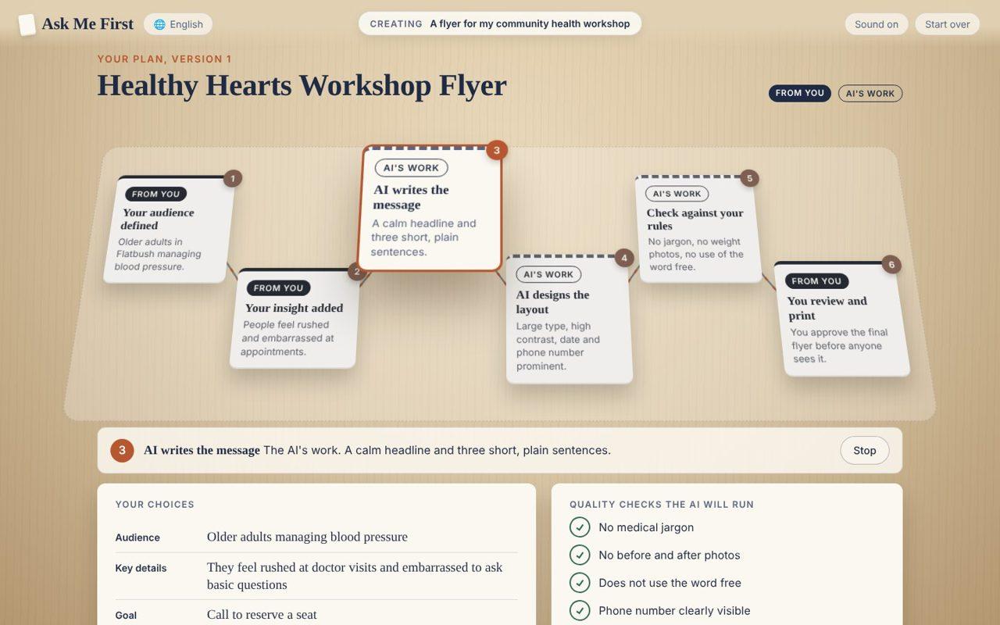
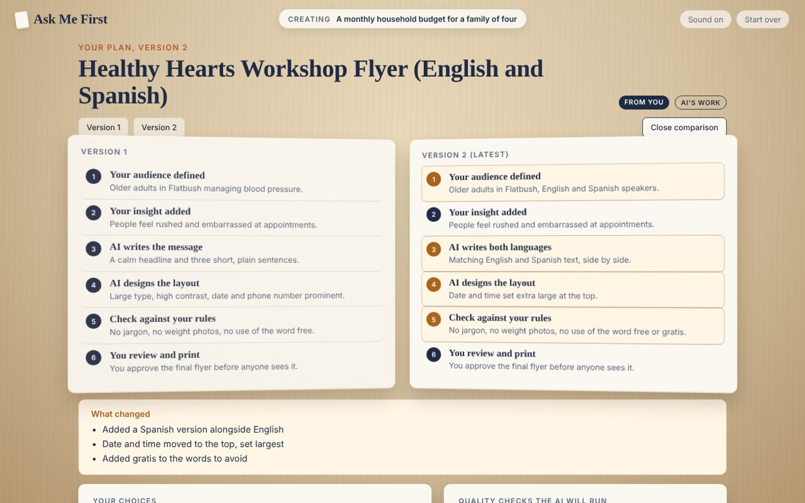
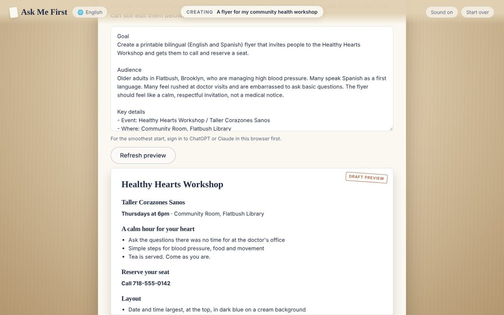
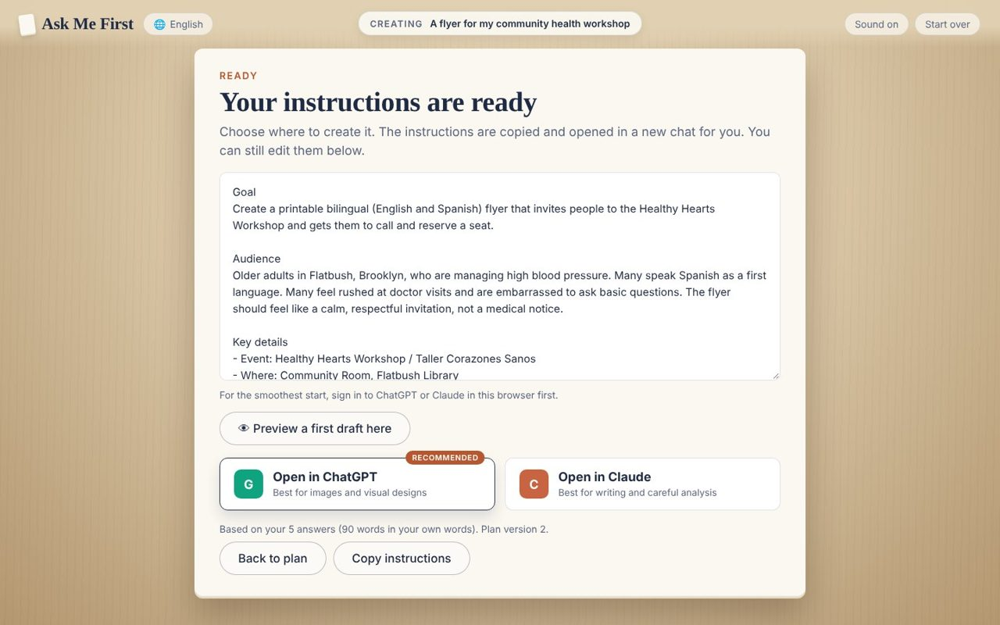
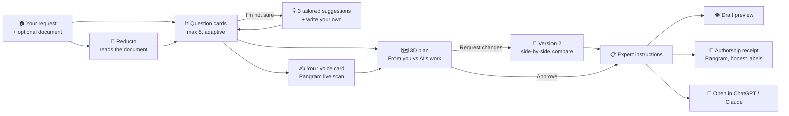

<div align="center">

# 🗂️ Ask Me First

### Most people don't know how to talk to AI. So this AI asks first.

**A few question cards on a kitchen table. A plan you can see. Expert instructions written from your own words.**

Built in one day, solo, for the **Non-Slop Hackathon** (Pangram × Nous Research × Reducto × Modal), Brooklyn, Nov 22, 2026.

*Theme: "What matters when you can generate anything? Can you explain your choices?"*



</div>

---

## 🧭 The idea in one minute

A bakery owner, a nurse, a grandparent or a teacher opens ChatGPT, types *"make a poster for my sale"*, and gets something generic. The problem isn't the AI. It's that nobody told them **what to tell it**.

**Ask Me First** turns that blank box into a short, friendly interview:

1. **You say what you want**, in any words. Pick a card or type it, and attach an old flyer, resume or photo if you have one.
2. **It asks up to 5 question cards**, each one about *your* thing ("Who will see your bakery's weekend sale poster?"), building on what you already said.
3. **You see the plan** as a 3D flow showing which steps came from you and which are the AI's work. Change anything and compare versions side by side.
4. **You leave with expert instructions** written from your own words, opened directly in ChatGPT or Claude with one click. You can preview a first draft before you go.

> The output is not "a better prompt." It is **your choices, made visible**. The app never even uses the word "prompt."

---

## 🎴 The experience, screen by screen

| | |
|:--:|:--:|
| <br>**It checks it understood you.** Card 1 restates your request in one plain sentence, with an *Edit request* link if it got it wrong. | <br>**"I'm not sure" is a real answer.** Three suggestions tailored to your request and earlier answers, plus a blank card to write your own. Tap several to combine them. |
| <br>**Every card flips over to explain why it's asking.** This quietly teaches what makes AI output good. | <br>**The plan plays itself.** Each step lifts toward you in 3D while a caption explains it, marked *your decision* or *the AI's work*. |
| <br>**Change it, then compare.** Request a change, get Version 2, and open both versions side by side like a book, with every changed step highlighted. | <br>**See a first draft before you leave.** A short preview of the real result on a paper sheet: a table for a budget, the exact text for a poster. |

<div align="center">
<br>
<b>The handoff.</b> Editable instructions, plus <i>Open in ChatGPT</i> (recommended for images) or <i>Open in Claude</i> (writing and analysis). The text is pre-filled in a new chat and copied to your clipboard as a backup.
</div>

*Screenshots use the built-in demo run (a community health workshop flyer). Live runs adapt to any request.*

---

## ✨ Interactive by design: 3D and 4D, with a reason for each

The whole interface is a **kitchen table with index cards**: paper, ink and a recipe box. Paper feels human and unhurried, the opposite of slop. Every motion means something, and **everything holds still when you need to read**.

| Interaction | What you feel | Why it's there |
|---|---|---|
| 🃏 **Cards dealt from a deck** | Each question slides off a deck on a tilted 3D table and lifts flat to face you | One question at a time is calmer than a chat box |
| 🔄 **3D flip: "Why this matters"** | The card turns over to show one sentence explaining the question | Teaches people *how* to work with AI without a lecture |
| 📥 **Answers fly into a recipe box** | Each answered card drops into "Your choices," and the counter ticks up | Your input visibly piles up; it's yours |
| 🌀 **Shuffling deck while the AI thinks** | Cards riffle in 3D instead of a spinner | Waiting feels alive, not broken |
| 🖱️ **Tilt and light** | The table tilts with your mouse; home cards tilt toward the cursor with a moving light sheen | Physical, touchable depth |
| ⏱️ **The plan as a 4D walkthrough** | A flowing line runs along the plan path while each step lifts forward over time, with captions | Shows **how AI actually helps**: your decisions, then its work, then your review |
| 📖 **Versions open like a book** | Version 1 and Version 2 swing open side by side, changes highlighted | You can explain every change |
| 📄 **Draft preview unfolds** | A paper draft rotates up into view, stamped "Draft preview" | The result is real before you leave |
| 🎙️ **Voice in, voice out** | Speak any answer; tap *Read aloud* on any card | For people who'd rather talk or listen than type or read |
| 🌐 **Any language** | Pick from 16 languages (or type any other); the screen translates, and questions, plan, instructions, voice input and read-aloud follow. Right-to-left languages display correctly | Many people who need help most don't use English |
| ✍️ **Live Pangram scan** | On the "Your voice" card, a ring fills toward 50 words, then a scan line sweeps your text and Pangram highlights each section, stamping *Verified: your own words* | Your real voice becomes the style guide for the AI |
| 🧾 **Authorship receipt** | The final card shows Pangram's reading of your words and, honestly, of the AI draft, plus an optional "Created by [name] with drafting help from AI" line | Disclosure, not disguise |
| 🔈 **Paper sounds** | Soft synthesized ticks for dealing, flipping and stamping (toggle in the corner) | Tactile feedback, with nothing to download |

**Accessibility first:** large type, high contrast, real buttons (never gesture-only), keyboard support, voice optional, and full support for `prefers-reduced-motion` (the animations switch off).

---

## 🔁 How it works



### Under the hood

- **The server keeps the interview on track; the AI writes it.** The backend decides which topics are still open (audience, goal, key details, style, limits, plus a one-time follow-up when an answer is vague) and enforces the 5-card cap. The model writes each question, its "why," and three suggestions as strict JSON, grounded in the request, earlier answers and any attached document.
- **The plan is structured.** The model returns the visual plan (steps tagged `you` or `ai`, choices, quality checks) as JSON, and the full instructions in a separate tagged block, so quotation marks can never break the reply.
- **It never stalls.** Every AI call has a time budget, a retry and a provider chain (Hermes, then Claude, then OpenAI-compatible). If everything fails, a **domain-aware safety net** (career, finance, events, education, business, visual and more) still asks relevant questions that name your request.
- **Stage-proof.** `DEMO_MODE=1` replays a full recorded run with realistic timing if the wifi dies.

---

## 🧪 Can I explain my choices? Yes.

| Choice | Reason |
|---|---|
| **Cards, not a chat box** | Non-experts write requests the way they'd talk to a person and explore unsystematically (*Why Johnny Can't Prompt*, Zamfirescu-Pereira et al., CHI 2023). A guided card asks the way a good consultant would. |
| **Five questions maximum** | Follow-up questions made AI-written documents preferred 41 to 25, and 84% of participants said they'd answer them for better results (Tix, *Follow-Up Questions Improve Documents Generated by LLMs*, 2024). Short and structured beats endless back-and-forth. |
| **Quality checks built into every plan** | Clarifying questions raise satisfaction, but people then review less and accept more errors (Zheng et al., *Is That Clear?*, arXiv preprint, Nov 2026). So every plan carries checks drawn from your own "never" rules, and the instructions tell the AI to verify each one. |
| **"From you" vs "AI's work" on every step** | When you can generate anything, what matters is who decided what. The plan makes authorship visible. |
| **Pangram as a quiet badge, never a gate** | It reads only *your own* answers (50+ words, never the AI's output) and either confirms they're in your own words or politely suggests saying it your way. It never blocks, never scores, and never loops text to "beat" the detector, consistent with Pangram's stance that disclosed AI help is fine and detection shouldn't be a witch hunt. |
| **A voice sample instead of a "humanizer"** | We never disguise AI text. The person describes their idea the way they'd tell a friend, Pangram confirms it's their own writing, and the instructions tell the AI to write in that voice (plain words, their phrasing, no stock AI phrases). Output sounds human because it's built on a real human, and the receipt labels AI help honestly. |
| **Any language** | The people who benefit most often aren't English speakers. Every AI step follows the chosen language. |
| **Hand off to ChatGPT or Claude** | Works for *any* task in *any* domain, including images. We recommend the right tool for the job instead of rebuilding it. |
| **Paper and 3D, not neon and sparkles** | Paper is slow and human. The 3D is physical, every animation explains something, and reading moments stay still. |

**Who it's for:** about half of U.S. adults (51%) say they never use AI chatbots, including roughly three in four adults 65 and older (Pew Research Center, survey of 5,119 adults, Feb 2026). Ask Me First is built for them.

---

## 🧰 Built with

| Tool | Its real job here |
|---|---|
| **Nous Research · Hermes 4** (Nous Portal API) | Primary model for questions, suggestions, plans and instructions; picks the best live Hermes model automatically |
| **Anthropic Claude** | Backup model in the same provider chain, used whenever Hermes is unavailable |
| **Reducto** | Parses an uploaded flyer, resume, form or photo so the questions and instructions build on it |
| **Pangram** | Live scan of the person's own voice sample (per-section reading and a verified stamp), plus an honest label on the AI draft in the authorship receipt |
| **Modal** | One-command deployment of the FastAPI app (`backend/modal_app.py`) |
| **FastAPI + one hand-written `index.html`** | No build step. CSS 3D transforms, GSAP, Web Speech API, Web Audio |

---

## 🚀 Run it locally

```bash
git clone git@github.com:AKilalours/AskmeFirst.git
cd AskmeFirst/backend
pip install -r requirements.txt
cp .env.example .env          # add your keys (never commit .env)
python smoke_test.py          # checks Hermes/Claude, Pangram and Reducto
uvicorn main:app --reload --port 8000
# open http://localhost:8000
```

**Keys (`backend/.env`):** `NOUS_API_KEY`, `ANTHROPIC_API_KEY` (backup), `PANGRAM_API_KEY`, `REDUCTO_API_KEY`. Keys stay on the server and never reach the browser.

**Offline stage mode:** set `DEMO_MODE=1` to replay a recorded run.

**Deploy:** `modal setup` then `modal deploy backend/modal_app.py`.

```
AskmeFirst/
├── backend/
│   ├── main.py           # API: questions, plan, preview, Pangram, Reducto, provider chain
│   ├── fallbacks.py      # domain-aware safety-net questions and plans
│   ├── demo_cache.json   # recorded run for DEMO_MODE
│   ├── smoke_test.py     # one call to every service
│   └── modal_app.py      # Modal deployment
├── frontend/index.html   # the whole interactive UI, no build step
└── docs/screens/         # screenshots used in this README
```

---

## 🔍 Honest notes

- **Which model ran:** the app records which provider answered each step (`hermes`, `claude` or `fallback`) in `backend/runs/live.jsonl`. During the hackathon build, Claude served as the live model while Hermes access was being set up.
- **Research citations** are from the sources named above. The Zheng et al. paper is an arXiv preprint, not yet peer-reviewed.
- **Pangram's label is a reading, not a verdict.** Detectors are less reliable on short or list-like text, which is why the app needs 50+ words and never blocks anyone.
- **The ChatGPT and Claude buttons** pre-fill a new chat. You need to be signed in, and the text is always copied to your clipboard as a backup.

---

<div align="center">

**Made by Akila Lourdes** · MS in AI, LIU Brooklyn

*"When you can generate anything, what matters is what you chose."*

</div>
